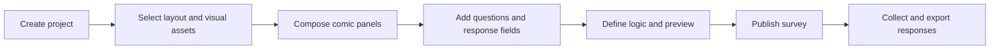
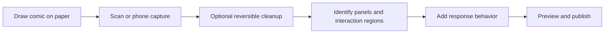
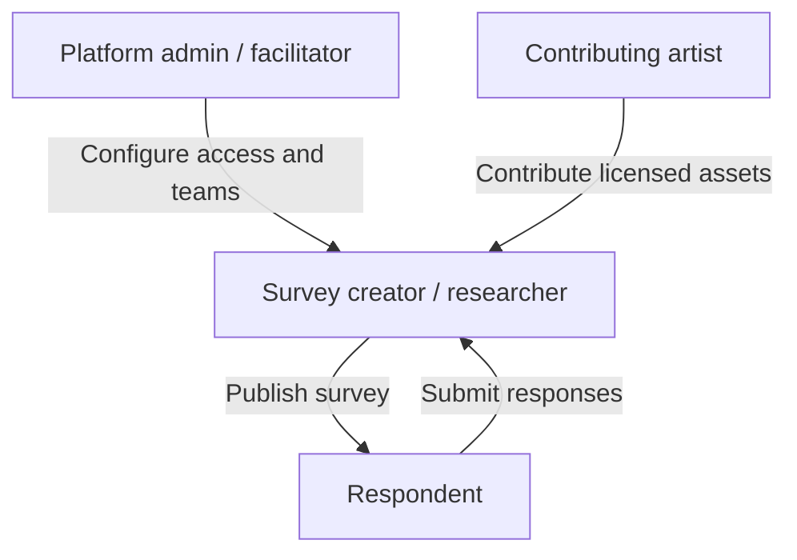

# Proposed workflows and capabilities

> **Conceptual only.** These flows are discussion tools, not evidence of implemented screens or systems.

## Main Builder: digital-first

Questions for this flow include responsive layouts, handling alternate reading orders, accessibility for image-based content, and how precisely the editor maps visual regions to survey components.

## Experiment Room: paper-first

A workshop-oriented variation may use a QR code to open a capture-only mobile interface connected to a team's workspace. Whether users can edit individual imported layers or must re-upload revised artwork remains open.

## Suggested roles

These represent possible roles, not a finalized authorization system. Publishing, review, and editing permissions need separate decisions.

## Candidate feature groups

| Area | Potential capabilities |
| --- | --- |
| Composition | Panel layouts, layers, reusable characters, speech bubbles, effects |
| Survey authoring | Question types, validation, conditions, branching, previews |
| Publishing | Shareable URLs, embeds, potentially custom domains |
| Asset management | Artist profiles, attribution, licensing, collections |
| History | Survey revisions, asset version references, restoration |
| Responding | Text, voice, drawing, optional video |
| Research | Structured exports, response metadata, consent records, study archives |

## Known constraints to retain in design

AI assistance, if used, should teach **general comics techniques** through neutral examples, such as generic diagrams showing framing, pacing, or gutters. It should not auto-author participant-specific comic stories or generate panel art. Research ethics and consent must be considered throughout.